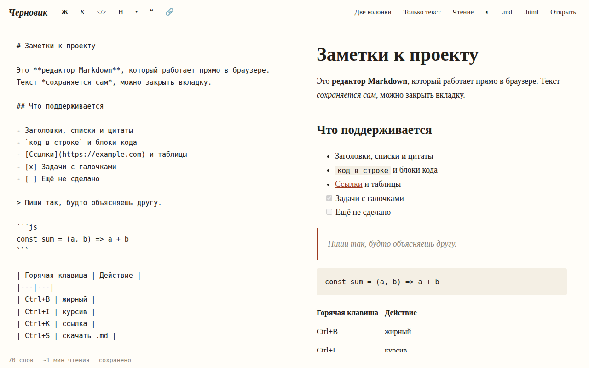

# Черновик: редактор Markdown

Редактор Markdown с живым предпросмотром, который работает в браузере без сервера. Парсер написан с нуля (`md.js`, около 80 строк), без библиотек.



## Возможности

**Разметка**
- Заголовки шести уровней, абзацы, переносы строк, горизонтальная линия
- Маркированные и нумерованные списки, задачи `[x]` и `[ ]`
- Цитаты, в том числе с вложенной разметкой
- Блоки кода с указанием языка и `код в строке`
- Таблицы, ссылки, картинки, **жирный**, *курсив*, ~~зачёркнутый~~

**Редактор**
- Панель кнопок: жирный, курсив, код, заголовок, список, цитата, ссылка
- Горячие клавиши Ctrl+B, Ctrl+I, Ctrl+K (ссылка), Ctrl+S (скачать .md); работают и в русской раскладке
- Tab вставляет два пробела вместо ухода фокуса
- Три режима: две колонки, только текст, чтение
- Синхронная прокрутка предпросмотра вслед за текстом
- Автосохранение черновика в localStorage через полсекунды после ввода
- Счётчик слов и примерное время чтения
- Открытие файлов .md и .txt, экспорт в .md и в готовую HTML-страницу; имя файла берётся из первого заголовка
- Тёмная тема, режим и тема запоминаются
- При печати остаётся только предпросмотр

## Стек

HTML5, CSS3, JavaScript без библиотек, собственный парсер Markdown, localStorage, File API.

## Как запустить

Сборка не нужна: откройте `index.html` в браузере.

Или через локальный сервер:

```bash
python -m http.server 8000
# затем откройте http://localhost:8000
```

## Структура проекта

```
index.html      # интерфейс редактора, стили, горячие клавиши, экспорт
md.js           # парсер Markdown: Markdown.parse(text) -> { html, toc }
screenshot.png  # скриншот для README
LICENSE         # лицензия MIT
```

## Как это устроено

- Парсер построчный: блоки (код, заголовки, цитаты, списки, таблицы, абзацы) распознаются регулярными выражениями, цитаты разбираются рекурсивно.
- Безопасность: весь текст экранируется до применения разметки, код в строке вынимается заранее и возвращается без обработки, а адреса ссылок и картинок проходят белый список (`http(s):`, `mailto:`, якоря, относительные пути, имена файлов картинок). Ссылки вида `javascript:` заменяются на `#`.
- Заголовкам выставляются `id` из текста (кириллица поддерживается), а `parse()` дополнительно возвращает оглавление по уровням 1-3.
- Парсер подключается и в браузере (`window.Markdown`), и в Node через `module.exports`.
- Вставка разметки сделана через `setRangeText`: выделенный текст оборачивается, и выделение остаётся на нём.
- На узком экране показывается одна панель, режим «Чтение» переключает её на предпросмотр.

## Идеи для развития

- Боковая панель с оглавлением (данные уже возвращает `parse()`)
- Подсветка синтаксиса в блоках кода
- Несколько заметок со списком вместо одного черновика

## Лицензия

MIT © 2026 whysafe. Telegram: [@yawhysafe](https://t.me/yawhysafe) · Сайт: [whysafe.ru](https://whysafe.ru)
